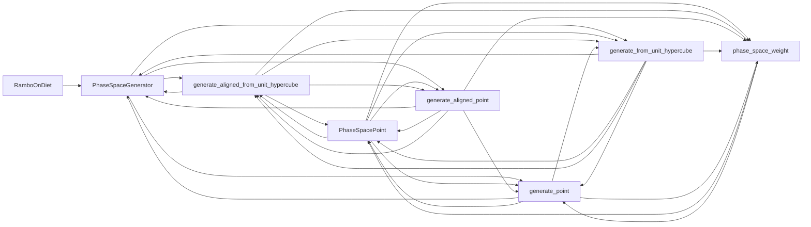

# Discoverability graph

Help links between the exported names of `RamboOnDiet`. An arrow points from a help page to a page a reader can open next. The entry point is `RamboOnDiet`, which a reader opens by name. Any other name with no incoming link is hard to find. A name with no outgoing link is a dead end. Every exported name needs an outgoing link and a path from the entry point.

## Link counts

| Name | Incoming | Outgoing |
| --- | ---: | ---: |
| PhaseSpaceGenerator | 5 | 4 |
| PhaseSpacePoint | 5 | 5 |
| RamboOnDiet (entry) | 0 | 1 |
| generate_aligned_from_unit_hypercube | 4 | 5 |
| generate_aligned_point | 3 | 5 |
| generate_from_unit_hypercube | 4 | 5 |
| generate_point | 5 | 4 |
| phase_space_weight | 5 | 2 |
